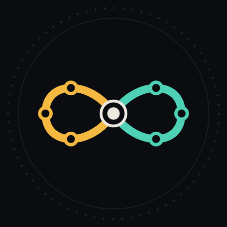

# eternal

**An infinity loop drawn as a git graph.**
 
commit → branch → merge → repeat

---

### The mark

| Part | Meaning |
|---|---|
| 🟡 **Gold loop** | `main`: the stable trunk, the history you keep |
| 🟢 **Teal loop** | a branch: experiments that leave and come back |
| ◯ **Hollow dots** | commits, drawn like a `git log --graph` |
| ● **Centre node** | the merge, where both paths meet |
| ⋯ **Ticked ring** | time: 72 ticks like a clock face; sits inside GitHub's circular avatar crop |

On-chain, nothing is deleted. Every block points back to the one before it. **eternal** is about that idea: build in public, keep the history, keep shipping.

### Palette

| Name | Hex | Use |
|---|---|---|
| Void | `#0A0C10` | background |
| Ember | `#F5B841` | main loop, highlights |
| Tide | `#4FD1B5` | branch loop, status |
| Bone | `#ECE8DF` | merge node, text |

### Assets

| File | Use |
|---|---|
| [`eternal-logo.svg`](./eternal-logo.svg) | avatar / mark, 460×460 |
| [`banner.svg`](./banner.svg) | animated header, 1280×320 |

Free to use. Made for a web3 profile.

